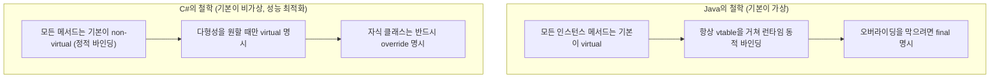
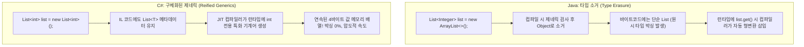

# Java vs C# 객체지향 프로그래밍(OOP) 핵심 원리와 언어 비교 바이블

> **본 문서는 Java 객체지향 프로그래밍 강의 커리큘럼을 기반으로, C#과의 1:1 비교 분석을 통해 두 언어의 런타임 메커니즘과 객체지향 설계의 본질을 꿰뚫는 복습 및 기술 면접 대비 마크다운 가이드입니다.**
> 자매 가이드: [C# 아키텍처 바이블: 근본 원리부터 클린 아키텍처까지](csharp_architecture_core_guide.md)

---

## 📑 전체 목차

1. [인스턴스와 클래스 & 객체 생성 메커니즘](#1-인스턴스와-클래스--객체-생성-메커니즘)
2. [정보 은닉과 캡슐화 (Encapsulation)](#2-정보-은닉과-캡슐화-encapsulation)
3. [상속(Inheritance)과 가상 메서드 테이블 (vtable)](#3-상속inheritance과-가상-메서드-테이블-vtable)
4. [다형성(Polymorphism)과 타입 캐스팅](#4-다형성polymorphism과-타입-캐스팅)
5. [추상 클래스(Abstract Class) vs 인터페이스(Interface)](#5-추상-클래스abstract-class-vs-인터페이스interface)
6. [제네릭(Generic)의 근본 원리: Type Erasure vs Reified Generics](#6-제네릭generic의-근본-원리-type-erasure-vs-reified-generics)
7. [컬렉션 프레임워크와 핵심 자료구조](#7-컬렉션-프레임워크와-핵심-자료구조)
8. [인스턴스 기본 조작 (Object Contract & Immutability)](#8-인스턴스-기본-조작-object-contract--immutability)
9. [문자열 조작과 메모리 최적화](#9-문자열-조작과-메모리-최적화)
10. [단위 테스트 기초 (JUnit 5 vs xUnit)](#10-단위-테스트-기초-junit-5-vs-xunit)
11. [부록: Java vs C# OOP 핵심 기술 면접 20문 20답 & 종합 비교표](#11-부록-java-vs-c-oop-핵심-기술-면접-20문-20답--종합-비교표)

---

## 1. 인스턴스와 클래스 & 객체 생성 메커니즘

### 1.1 근본 원리: 클래스(Class)와 인스턴스(Instance)의 본질

* **가상 세계의 창조**: 객체지향 프로그래밍은 현실 세계의 개념과 상태를 컴퓨터 메모리에 모델링하는 작업입니다.
* **클래스(Class)**: 객체를 생성하기 위한 **틀(설계도, Blueprint)**입니다. 메서드 코드와 메타데이터는 프로세스의 메서드 영역(Method Area / Type Handle)에 단 한 번만 로드됩니다.
* **인스턴스(Instance / Object)**: `new` 연산자를 통해 힙(Heap) 메모리에 실제로 할당된 **실체**입니다. 각 인스턴스는 자신만의 필드 상태(데이터)를 독립적으로 유지합니다.
* **정적(Static) 멤버 vs 인스턴스(Instance) 멤버**:
  * 인스턴스 멤버: 객체가 생성될 때마다 힙에 개별적으로 할당됨.
  * 정적 멤버: 클래스가 메모리에 로드될 때 단 한 번 할당되며 모든 인스턴스가 공유함.

### 1.2 생성자 연쇄와 초기화 비교

생성자(Constructor)는 인스턴스가 힙에 생성될 때 필드를 유효한 초기 상태로 설정하는 특수 메서드입니다.

#### Java: 일반 생성자 및 `this()`, `super()`

```java
public class Hero {
    private String name;
    private int hp;

    // 기본 생성자
    public Hero() {
        this("이름없음", 100); // 다른 생성자 호출 (생성자 체이닝)
    }

    // 매개변수 생성자
    public Hero(String name, int hp) {
        this.name = name;
        this.hp = hp;
    }
}

public class SuperHero extends Hero {
    private boolean flying;

    public SuperHero(String name, int hp, boolean flying) {
        super(name, hp); // 부모 생성자 명시적 호출 (첫 줄 필수)
        this.flying = flying;
    }
}
```

#### C#: 생성자 이니셜라이저, 주 생성자(Primary Constructor) & 객체 이니셜라이저

C#은 더 간결하고 현대적인 생성자 문법을 제공합니다.

```csharp
// 1. 전통적인 생성자 체이닝 (: this(), : base())
public class Hero
{
    public string Name { get; set; }
    public int Hp { get; set; }

    public Hero() : this("이름없음", 100) { }

    public Hero(string name, int hp)
    {
        Name = name;
        Hp = hp;
    }
}

public class SuperHero : Hero
{
    public bool Flying { get; set; }

    public SuperHero(string name, int hp, bool flying) : base(name, hp)
    {
        Flying = flying;
    }
}

// 2. C# 12 주 생성자 (Primary Constructor)
public class ModernHero(string name, int hp)
{
    public string Name { get; } = name;
    public int Hp { get; set; } = hp;
}

// 3. 객체 이니셜라이저 (생성자 오버로딩 폭발을 막는 문법)
var hero = new Hero { Name = "배트맨", Hp = 200 };
```

---

## 2. 정보 은닉과 캡슐화 (Encapsulation)

### 2.1 근본 원리: 캡슐화의 본질은 "불변식(Invariant)의 수호"

초보 개발자는 캡슐화를 단순히 "변수를 `private`으로 숨기고 기계적으로 Getter/Setter를 만드는 것"으로 오해합니다.

* **캡슐화의 진짜 목적**:
  1. **데이터 보호**: 외부에서 허용되지 않은 값(예: 음수 나이, 비어 있는 이름)을 마구 주입해 객체의 상태를 오염시키는 것을 차단.
  2. **불변식(Invariant) 보장**: 객체가 생성되어 소멸할 때까지 스스로의 규칙을 엄격히 통제.
  3. **내부 구현의 은닉**: 내부 자료구조가 배열에서 해시맵으로 바뀌어도 외부 호출 코드에는 영향이 없도록 격리.

### 2.2 접근 제어자 비교

| 접근 제어자 | Java 범위 | C# 대응 키워드 | C# 범위 |
|---|---|---|---|
| `private` | 동일 클래스 내부만 | `private` | 동일 클래스/구조체 내부만 |
| *(default)* | 동일 패키지 내부 (Package-Private) | `internal` *(유사)* | 동일 어셈블리(.dll/.exe) 내부 |
| `protected` | 동일 패키지 + 다른 패키지의 상속 클래스 | `protected` | 상속 관계의 파생 클래스만 |
| *(없음)* | 없음 | `protected internal` | 동일 어셈블리 OR 파생 클래스 |
| *(없음)* | 없음 | `private protected` | 동일 어셈블리 AND 파생 클래스 |
| `public` | 모든 곳에서 접근 가능 | `public` | 모든 곳에서 접근 가능 |

### 2.3 프로퍼티(Property) 비교: 메서드 vs 언어 차원의 속성

#### Java: 관례적 메서드 & Lombok

Java는 문법적으로 속성(Property) 개념이 없어 `getXXX()`, `setXXX()` 메서드를 직접 정의하거나 Lombok `@Getter/@Setter`에 의존합니다.

```java
public class Person {
    private String name;
    private int age;

    public String getName() { return name; }

    public void setAge(int age) {
        if (age < 0) {
            throw new IllegalArgumentException("나이는 음수가 될 수 없습니다.");
        }
        this.age = age;
    }
}
```

#### C#: 언어 차원의 프로퍼티 & `init` 전용 접근자

C#은 속성을 일급 언어 기능으로 지원하며, C# 9.0부터 객체 생성 시점에만 초기화 가능한 `init` 접근자를 지원합니다.

```csharp
public class Person
{
    // 자동 구현 프로퍼티 (Backing Field 자동 생성)
    public string Name { get; init; } // 생성 이후 수정 불가 (불변성 보장)

    private int _age;
    public int Age
    {
        get => _age;
        set
        {
            if (value < 0)
                throw new ArgumentException("나이는 음수가 될 수 없습니다.");
            _age = value;
        }
    }
}

// 사용부
var p = new Person { Name = "홍길동", Age = 25 };
// p.Name = "이순신"; // 컴파일 에러! (init 전용)
```

---

## 3. 상속(Inheritance)과 가상 메서드 테이블 (vtable)

### 3.1 근본 원리: 상속의 본질과 "다이아몬드 문제"

* **상속(Inheritance)**: 기존 클래스의 필드와 메서드를 물려받아 새로운 클래스를 정의하는 기법(`is-a` 관계 성립 시에만 사용).
* **다중 상속(Multiple Inheritance) 금지 이유**: 두 부모 클래스에 동일한 이름의 메서드가 정의되어 있을 때 어느 부모의 것을 호출해야 할지 모호해지는 **다이아몬드 문제(Diamond Problem)**가 발생하므로, Java와 C# 모두 다중 클래스 상속을 금지하고 단일 상속만 허용합니다.

### 3.2 Java vs C# 가상 메서드 테이블(vtable)의 결정적 차이 (기술 면접 1순위)

이 부분은 Java와 C#의 런타임 철학이 가장 극명하게 갈리는 지점입니다.



#### (1) Java 코드: 암묵적 가상 메서드

```java
public class Parent {
    public void SayHello() {
        System.out.println("Parent");
    }
}

public class Child extends Parent {
    @Override // 단순 어노테이션 (생략해도 가상 오버라이딩 동작)
    public void SayHello() {
        System.out.println("Child");
    }
}

Parent p = new Child();
p.SayHello(); // 출력: "Child" (런타임 객체 타입에 따라 동적 호출)
```

#### (2) C# 코드: 명시적 `virtual`, `override` vs `new` (메서드 하이딩)

C#에서는 기본 메서드가 비가상이므로 상위 타입 변수로 호출하면 부모의 메서드가 직통으로 실행됩니다.

```csharp
public class Parent
{
    // virtual이 없으면 비가상 메서드
    public void NonVirtualMethod() => Console.WriteLine("Parent NonVirtual");
    public virtual void VirtualMethod() => Console.WriteLine("Parent Virtual");
}

public class Child : Parent
{
    // new: 부모의 비가상 메서드를 숨김 (Method Hiding)
    public new void NonVirtualMethod() => Console.WriteLine("Child Hiding");

    // override: 부모의 가상 메서드를 vtable에서 교체 (Overriding)
    public override void VirtualMethod() => Console.WriteLine("Child Override");
}

Parent p = new Child();
p.NonVirtualMethod(); // 출력: "Parent NonVirtual" (컴파일 타임 정적 바인딩!)
p.VirtualMethod();    // 출력: "Child Override"    (vtable 동적 바인딩!)
```

> **면접 포인트 요약**:
> Java는 기본이 동적 바인딩(가상 메서드)이므로 안전한 다형성을 우선시하지만 vtable 탐색 오버헤드가 있습니다.
> C#은 기본이 정적 바인딩이므로 함수 호출 성능(인라인 최적화)을 극대화하고, 다형성이 필요한 경우에만 명시적으로 `virtual`/`override`를 선언하도록 설계되었습니다.

---

## 4. 다형성(Polymorphism)과 타입 캐스팅

### 4.1 근본 원리: "하나의 메시지, 다양한 행동"

다형성은 **동일한 인터페이스(메서드 호출)에 대해 각 객체가 저마다의 고유한 방식으로 응답**할 수 있는 능력입니다.

* **업캐스팅 (Upcasting)**: 자식 인스턴스를 부모 타입 변수에 대입 $\rightarrow$ **100% 안전하며 암시적 변환 가능**.
* **다운캐스팅 (Downcasting)**: 부모 타입 변수를 원래의 구체 자식 타입으로 복원 $\rightarrow$ **위험하며 명시적 형변환 필요** (실제 객체가 맞지 않으면 런타임 에러).

### 4.2 안전한 타입 검사와 패턴 매칭 비교

#### Java: `instanceof`의 진화

```java
// Java 14 이전
if (monster instanceof Slime) {
    Slime s = (Slime) monster; // 번거롭고 위험한 명시적 캐스팅
    s.runAway();
}

// Java 16+ 패턴 매칭 instanceof
if (monster instanceof Slime s) {
    s.runAway(); // 타입 검사와 캐스팅 변수 바인딩을 동시에 수행
}
```

#### C#: `is`, `as` 연산자와 스위치 식 패턴 매칭

```csharp
// 1. as 연산자: 형변환 실패 시 예외를 던지지 않고 null 반환
Slime? s = monster as Slime;
if (s != null)
{
    s.RunAway();
}

// 2. is 패턴 매칭 (C# 7+)
if (monster is Slime slime)
{
    slime.RunAway();
}

// 3. 패턴 매칭 switch 식 (현대 C# 실무 표준)
string action = monster switch
{
    Slime s => $"슬라임 {s.Suffix}가 도망쳤습니다.",
    Goblin g => $"고블린이 몽둥이를 휘두릅니다. 공격력: {g.AttackPower}",
    _ => "알 수 없는 몬스터입니다."
};
```

---

## 5. 추상 클래스(Abstract Class) vs 인터페이스(Interface)

### 5.1 근본 원리: "무엇인가(is-a)" vs "무엇을 할 수 있는가(can-do)"

| 구분 | 추상 클래스 (Abstract Class) | 인터페이스 (Interface) |
|---|---|---|
| **존재 이유** | 하위 클래스들의 **공통 상태(필드)와 기본 로직을 공유** | 클래스가 외부 세계에 제공하는 **행동 규약(Contract)을 정의** |
| **관계** | 밀접한 상속 계층 (`is-a`) | 다형적 행동 장착 (`can-do` / `has-a`) |
| **다중 구현** | 불가능 (단일 상속만 지원) | **다중 구현(Multiple Implementation) 가능** |
| **필드(상태)** | 인스턴스 필드(변수)를 자유롭게 가질 수 있음 | 상태(인스턴스 필드)를 가질 수 없음 |

### 5.2 현대 언어의 확장과 C# 명시적 인터페이스 구현

최신 Java(Java 8+)와 C#(C# 8.0+) 모두 인터페이스에 **기본 구현 메서드(Default Method)**를 작성할 수 있게 진화했습니다.

#### C#만의 필살기: 명시적 인터페이스 구현 (Explicit Interface Implementation)

두 개의 서로 다른 인터페이스에 우연히 동일한 이름의 메서드가 있을 때 충돌을 우아하게 해결합니다.

```csharp
public interface IPlayer
{
    void Attack();
}

public interface IMonster
{
    void Attack();
}

// 두 인터페이스의 Attack을 완벽히 격리하여 따로 구현
public class HybridCharacter : IPlayer, IMonster
{
    void IPlayer.Attack()
    {
        Console.WriteLine("플레이어로서 무기를 휘두릅니다.");
    }

    void IMonster.Attack()
    {
        Console.WriteLine("몬스터로서 발톱으로 공격합니다.");
    }
}

// 호출 시 해당 인터페이스로 캐스팅하여 명시적으로 호출
HybridCharacter hc = new HybridCharacter();
// hc.Attack(); // 컴파일 에러! (직접 노출되지 않음)

((IPlayer)hc).Attack();  // "플레이어로서 무기를 휘두릅니다."
((IMonster)hc).Attack(); // "몬스터로서 발톱으로 공격합니다."
```

---

## 6. 제네릭(Generic)의 근본 원리: Type Erasure vs Reified Generics

### 6.1 컴파일러와 런타임의 거대한 차이

이 주제는 **Java 개발자와 C# 개발자를 구분하는 가장 깊은 런타임 아키텍처 질문**입니다.



### 6.2 비교 분석표

| 비교 항목 | Java (Type Erasure) | C# (Reified Generics) |
|---|---|---|
| **제네릭 소거 시점** | **컴파일 시점**에 타입 정보가 완전히 지워짐 | **런타임(CLR)까지 타입 메타데이터가 완벽 보존됨** |
| **원시 타입 지원** | 불가능 (`List<int>` 불가 $\rightarrow$ `List<Integer>` 필수) | **완벽 지원 (`List<int>`, `List<float>` 등)** |
| **박싱(Boxing) 오버헤드** | 원시 타입을 래퍼 객체로 포장하므로 **심각한 힙 할당 발생** | **박싱이 전혀 발생하지 않음 (순수 값 타입 배열)** |
| **런타임 타입 검사** | `list instanceof List<String>` 검사 불가능 | `if (list is List<string>)` 완벽 가능 |
| **새 인스턴스 생성** | `new T()` 직접 생성 불가능 | `where T : new()` 제약으로 `new T()` 가능 |

---

## 7. 컬렉션 프레임워크와 핵심 자료구조

### 7.1 자료구조의 빅오(Big-O)와 선택 기준

1. **배열 / List (`ArrayList` / `List<T>`)**:
   * 메모리에 연속적으로 배치되는 동적 배열.
   * 인덱스 접근(`list[i]`): $O(1)$ $\rightarrow$ 조회가 빈번할 때 최상.
   * 중간 삽입/삭제: $O(N)$ (뒤의 요소들을 밀거나 당겨야 함).
2. **Set (`HashSet` / `HashSet<T>`)**:
   * 중복을 허용하지 않는 고유 집합.
   * 해시 함수를 통해 인덱스를 산출하여 탐색/추가/삭제 $O(1)$.
3. **Map / Dictionary (`HashMap` / `Dictionary<TKey, TValue>`)**:
   * 키(Key)-값(Value) 쌍 저장소.
   * Key의 해시코드를 기반으로 버킷에 접근하므로 조회 $O(1)$.

### 7.2 Java vs C# 컬렉션 1:1 대조표

| 개념 | Java Collection Framework | .NET (C#) Generic Collections |
|---|---|---|
| 동적 배열 | `java.util.ArrayList<E>` | `System.Collections.Generic.List<T>` |
| 연결 리스트 | `java.util.LinkedList<E>` | `System.Collections.Generic.LinkedList<T>` |
| 해시 기반 집합 | `java.util.HashSet<E>` | `System.Collections.Generic.HashSet<T>` |
| 정렬된 집합 | `java.util.TreeSet<E>` (Red-Black Tree) | `System.Collections.Generic.SortedSet<T>` |
| 해시 테이블 | `java.util.HashMap<K, V>` | `System.Collections.Generic.Dictionary<TKey, TValue>` |
| 순회 인터페이스 | `Iterable<T>`, `Iterator<T>` | `IEnumerable<T>`, `IEnumerator<T>` |

---

## 8. 인스턴스 기본 조작 (Object Contract & Immutability)

### 8.1 최상위 클래스의 규약 (Object Contract)

모든 객체의 조상인 `Object` 클래스(Java: `java.lang.Object`, C#: `System.Object`)는 인스턴스의 기본 동작을 정의합니다.

#### (1) `equals` / `Equals`와 `hashCode` / `GetHashCode`의 철칙

> **황금률**: 두 객체가 `equals`에 의해 같다고 판정되면, 두 객체의 `hashCode`는 **반드시 동일한 정수값**을 반환해야 한다!

* 이유: `HashSet`이나 `HashMap`/`Dictionary`는 데이터를 찾을 때 먼저 `hashCode`를 계산해 버킷을 찾은 뒤, 버킷 안에서 `equals`를 비교합니다. `hashCode`를 재정의하지 않으면 내용이 같아도 서로 다른 버킷으로 분류되어 조회가 실패합니다.

#### Java 구현 예시

```java
public class Account {
    private String accountNumber;
    private int balance;

    @Override
    public boolean equals(Object o) {
        if (this == o) return true;
        if (o == null || getClass() != o.getClass()) return false;
        Account account = (Account) o;
        return Objects.equals(accountNumber, account.accountNumber);
    }

    @Override
    public int hashCode() {
        return Objects.hash(accountNumber);
    }
}
```

#### C# 구현 예시 및 `record`

C#에서는 메서드 오버라이드뿐만 아니라 `==` 연산자 오버로딩까지 관례적으로 작성합니다. 그러나 최신 C#에서는 **`record`**를 사용하면 이 모든 코드가 한 줄로 자동 완성됩니다.

```csharp
// 수동 구현 방식
public class Account : IEquatable<Account>
{
    public string AccountNumber { get; set; }

    public override bool Equals(object? obj) => Equals(obj as Account);
    public bool Equals(Account? other) => other != null && AccountNumber == other.AccountNumber;
    public override int GetHashCode() => HashCode.Combine(AccountNumber);
    public static bool operator ==(Account? left, Account? right) => Equals(left, right);
    public static bool operator !=(Account? left, Account? right) => !Equals(left, right);
}

// 현대적 C# 해결책: record (값 기반 동등성, HashCode, ToString 자동 생성)
public record ModernAccount(string AccountNumber, int Balance);
```

### 8.2 정렬 규약: `Comparable` vs `Comparator`

* **`Comparable` (`IComparable<T>`)**: 객체 스스로가 가지는 **자연스러운 순서(Natural Ordering)** 정의 (`compareTo` / `CompareTo`).
* **`Comparator` (`IComparer<T>`)**: 기본 정렬 외에 **외부에서 주입하는 특별한 정렬 기준** (예: 나이순, 이름 역순).

---

## 9. 문자열 조작과 메모리 최적화

### 9.1 `String`의 불변성(Immutability)과 문자열 상수 풀

Java와 C#의 문자열은 모두 **불변(Immutable)**입니다.

```csharp
string s = "Hello";
s += " World"; // "Hello"가 수정되는 것이 아니라, 힙에 "Hello World"라는 새로운 인스턴스가 생성됨!
```

* **문자열 상수 풀 (String Intern Pool)**:
  * 리터럴로 선언된 문자열은 힙 내부의 인터닝 풀(Intern Pool)에 단 하나만 캐싱되어 메모리를 절약합니다.
* **대량 결합 시 `StringBuilder`의 필수성**:
  * 루프 안에서 `+` 연산자로 문자열을 계속 붙이면 수천 개의 쓰레기 객체가 힙에 생성되어 GC가 폭주합니다.
  * `StringBuilder`는 내부 가변 버퍼(char[])를 늘려가며 작업하므로 메모리 낭비 없이 $O(N)$으로 결합합니다.

### 9.2 문자열 서식화 비교

```java
// Java: String.format 또는 번거로운 결합
String msg = String.format("용사 %s의 남은 체력은 %d입니다.", hero.getName(), hero.getHp());
```

```csharp
// C#: 가독성과 컴파일 타임 검증이 뛰어난 문자열 보간 (String Interpolation)
string msg = $"용사 {hero.Name}의 남은 체력은 {hero.Hp}입니다.";
```

---

## 10. 단위 테스트 기초 (JUnit 5 vs xUnit)

### 10.1 테스트 프레임워크 1:1 비교

| 항목 | Java (JUnit 5) | C# (.NET xUnit) |
|---|---|---|
| **테스트 메서드 어트리뷰트** | `@Test` | `[Fact]` / `[Theory]`(파라미터 테스트) |
| **사전 준비 (Setup)** | `@BeforeEach void setUp()` | **클래스 생성자**에서 실행 |
| **사후 정리 (Teardown)** | `@AfterEach void tearDown()` | **`IDisposable.Dispose()`**에서 실행 |
| **단언문 클래스** | `org.junit.jupiter.api.Assertions` | `Xunit.Assert` |
| **동등성 검증** | `assertEquals(expected, actual)` | `Assert.Equal(expected, actual)` |
| **예외 발생 검증** | `assertThrows(Exception.class, () -> ...)` | `Assert.Throws<Exception>(() => ...)` |

---

## 11. 부록: Java vs C# OOP 핵심 기술 면접 20문 20답 & 종합 비교표

### 11.1 인터뷰 핵심 20선

#### Q1. 인스턴스와 클래스의 메모리 상 차이를 설명해 보세요

* **모범 답변**: 클래스는 프로세스 실행 시 메서드 영역(Method Area / Type Handle)에 타입 메타데이터와 정적 필드, 실행 바이트코드로 단 한 번 적재됩니다. 인스턴스는 런타임에 `new` 연산자를 호출할 때마다 힙(Heap) 메모리에 할당되는 실체이며, 각 인스턴스는 자신만의 필드 상태를 독립적으로 소유합니다.

#### Q2. 캡슐화(Encapsulation)를 달성하기 위해 단순히 private 필드와 Getter/Setter만 만들면 충분한가요?

* **모범 답변**: 아닙니다. 그것은 기계적인 데이터 노출에 불과합니다. 진정한 캡슐화는 객체 내부의 비즈니스 규칙과 불변식(Invariant)을 스스로 검증하고 수호하는 데 있습니다. "데이터를 달라고 요구하지 말고, 객체에게 일을 시켜라(Tell, Don't Ask)"는 원칙처럼, Setter로 외부에서 상태를 바꾸기보다 객체 스스로 상태를 변경하는 의미 있는 도메인 메서드를 제공해야 합니다.

#### Q3. Java와 C#의 가상 메서드(Virtual Method) 기본 철학 차이는 무엇인가요?

* **모범 답변**: Java는 모든 인스턴스 메서드가 기본적으로 가상 메서드(`virtual`)이므로 항상 vtable을 통한 동적 바인딩을 수행하며 오버라이딩을 막으려면 `final`을 써야 합니다. 반면 C#은 메서드 호출 성능(인라인 최적화)을 위해 기본적으로 비가상(정적 바인딩)이며, 다형성이 필요한 메서드에만 명시적으로 `virtual`을 붙이고 자식 클래스에서 `override`하도록 설계되었습니다.

#### Q4. C#에서 `override`와 `new`(메서드 하이딩)의 결정적 차이는 무엇인가요?

* **모범 답변**: `override`는 부모 클래스의 가상 메서드 테이블 엔트리를 자식의 메서드로 완전히 교체하여, 부모 타입 포인터로 호출해도 자식의 재정의 메서드가 실행됩니다. 반면 `new`는 가상 테이블을 건드리지 않고 컴파일 타임에 이름만 숨기는 것으로, 부모 타입 변수로 참조하면 부모의 원래 메서드가 호출됩니다.

#### Q5. Java의 타입 소거(Type Erasure)와 C#의 구체화된 제네릭(Reified Generics)의 성능 차이는?

* **모범 답변**: Java는 하위 호환성을 위해 컴파일 시점에 제네릭을 `Object`로 지워버리므로 `List<int>` 같은 원시 타입을 지원하지 못하고 래퍼 클래스(`Integer`) 박싱으로 인한 심각한 힙 할당과 GC 부하를 겪습니다. 반면 C#은 CLR 런타임까지 제네릭 메타데이터를 유지하여 JIT 컴파일러가 `int` 전용 연속 값 메모리 배열을 직접 기계어로 생성하므로 박싱이 전혀 없고 메모리와 속도 면에서 압도적으로 우수합니다.

#### Q6. `equals()` / `Equals()`를 재정의할 때 왜 `hashCode()` / `GetHashCode()`도 반드시 함께 재정의해야 하나요?

* **모범 답변**: 해시 기반 컬렉션(`HashSet`, `HashMap`/`Dictionary`)은 객체를 찾을 때 먼저 `hashCode`를 계산해 특정 버킷을 찾은 뒤, 버킷 내부에서 `equals`로 동등성을 검증합니다. 두 객체가 논리적으로 같더라도 `hashCode`가 다르면 애초에 엉뚱한 버킷을 뒤지게 되어 객체를 찾을 수 없거나 중복 저장되는 치명적인 버그가 발생합니다.

#### Q7. C#의 `record`는 클래스와 비교했을 때 어떤 내부적 차별점을 갖나요?

* **모범 답변**: `record`는 기본적으로 참조 타입(class)이지만, 컴파일러가 모든 프로퍼티를 기반으로 값 기반 동등성 비교(`Equals`, `GetHashCode`, `==`, `!=`), 가독성 높은 `ToString()`, 그리고 불변 복제를 지원하는 `with` 식 연산자를 자동으로 구현해 주어 불변 Value Object를 작성하기에 최적화되어 있습니다.

#### Q8. String이 불변 객체(Immutable)로 설계된 근본적인 이유는 무엇인가요?

* **모범 답변**: 첫째, 문자열 상수 풀(String Pool)을 통해 동일 리터럴을 안전하게 공유하여 메모리를 대폭 절약할 수 있습니다. 둘째, 값이 도중에 변하지 않으므로 멀티스레드 환경에서 동기화 락 없이도 완벽한 스레드 안전성을 보장합니다. 셋째, 해시코드 캐싱이 가능해 해시 기반 컬렉션의 Key로 안전하게 사용할 수 있습니다.

#### Q9. 대량의 문자열을 이어 붙일 때 `StringBuilder`를 써야 하는 이유는 무엇인가요?

* **모범 답변**: `String`은 불변이므로 `+` 연산 시마다 매번 새로운 문자열 객체를 힙에 할당하고 이전 문자열을 복사하여 GC에 막대한 부하를 줍니다. `StringBuilder`는 가변 char 버퍼를 내부적으로 소유하며 크기가 모자랄 때만 버퍼를 2배씩 확장하므로 메모리 재할당 횟수를 극적으로 줄여줍니다.

#### Q10. 다운캐스팅 시 명시적 캐스팅 `(Type)`보다 C#의 `as` 연산자나 패턴 매칭이 권장되는 이유는?

* **모범 답변**: 명시적 캐스팅은 실제 타입이 맞지 않을 경우 `InvalidCastException` 런타임 예외를 던져 프로그램이 비정상 종료되거나 큰 예외 처리 오버헤드를 발생시킵니다. 반면 `as` 연산자는 실패 시 안전하게 `null`을 반환하며, `is` 패턴 매칭은 타입 검사와 안전한 지역 변수 바인딩을 단 한 번에 수행하여 안전합니다.

#### Q11. 추상 클래스와 인터페이스 중 언제 어느 것을 선택해야 하는가요?

* **모범 답변**: 도메인 객체들 간에 긴밀한 `is-a` 계층 구조가 성립하고 공통 상태(필드) 및 기본 구현 코드를 깊이 공유해야 할 때는 **추상 클래스**를 사용합니다. 반면 서로 다른 클래스 계층에 공통된 능력이나 행동 계약(`can-do`)을 다형적으로 부여해야 하거나 다중 상속 효과가 필요할 때는 **인터페이스**를 선택합니다.

#### Q12. C#의 명시적 인터페이스 구현(Explicit Interface Implementation)의 용도는?

* **모범 답변**: 한 클래스가 두 개 이상의 인터페이스를 구현할 때 이름과 시그니처가 완전히 동일한 메서드가 존재하여 발생하는 이름 충돌을 분리하여 각각 따로 구현할 수 있게 해줍니다. 또한 인터페이스로 형변환했을 때만 해당 메서드를 외부에 노출시켜 클래스의 공개 API를 깔끔하게 유지할 수 있습니다.

#### Q13. 다중 상속(Multiple Inheritance)을 금지하는 결정적 이유는?

* **모범 답변**: 두 개 이상의 부모 클래스가 동일한 이름의 필드나 메서드를 소유하고 있을 때, 자식 클래스 입장에서 어느 부모의 것을 상속받아야 하는지 모호해지는 **다이아몬드 문제(Diamond Problem)**가 발생하기 때문입니다.

#### Q14. 정적(Static) 메서드는 왜 오버라이딩(Overriding)이 불가능한가요?

* **모범 답변**: 오버라이딩은 런타임에 힙에 있는 실제 객체의 vtable을 참조하여 동적으로 바인딩되는 다형성 메커니즘입니다. 그러나 정적 메서드는 객체 인스턴스가 아니라 클래스 타입 자체에 바인딩되어 컴파일 타임에 호출 주소가 고정(정적 바인딩)되므로 다형적 오버라이딩이 성립할 수 없습니다.

#### Q15. C#의 `struct`(구조체)와 `class`(클래스)의 메모리 할당 차이는?

* **모범 답변**: 클래스는 참조 타입(Reference Type)으로 힙(Heap) 메모리에 인스턴스가 할당되고 가비지 컬렉터의 수거 대상이 됩니다. 반면 구조체는 값 타입(Value Type)으로 주로 스택(Stack)이나 부모 객체의 메모리 내부에 인라인으로 직접 할당되어 할당과 해제가 매우 빠르고 GC 부하가 없습니다.

#### Q16. 객체지향 4대 특성(캡슐화, 상속, 다형성, 추상화)을 한 문장씩 요약해 보세요

* **모범 답변**:
  * **캡슐화**: 데이터와 이를 다루는 행위를 하나로 묶고 외부에 불필요한 세부를 감추어 무결성을 보호함.
  * **상속**: 기존 상위 클래스의 속성과 기능을 물려받아 재사용 및 확장하는 메커니즘.
  * **다형성**: 동일한 인터페이스나 메시지에 대해 실제 객체 타입에 따라 서로 다르게 반응하는 성질.
  * **추상화**: 복잡한 현실 세계의 본질적인 핵심 개념만 추려내어 단순화된 모델로 표현하는 기법.

#### Q17. Java의 `ArrayList`와 `LinkedList`는 어떤 상황에 각각 적합한가요?

* **모범 답변**: `ArrayList`는 연속된 메모리 배열 기반이므로 인덱스를 통한 $O(1)$ 임의 접근과 순회 성능(CPU 캐시 지역성)이 뛰어나 조회가 많을 때 적합합니다. `LinkedList`는 노드 포인터 연결 기반이므로 리스트의 맨 앞이나 특정 반복자 위치에서의 잦은 삽입/삭제($O(1)$)가 필요할 때 유리합니다.

#### Q18. 해시 테이블(HashMap, Dictionary)에서 해시 충돌(Hash Collision)이 일어났을 때 해결하는 대표적 기법 2가지는?

* **모범 답변**:
  * **Chaining (체이닝)**: 동일한 해시 버킷 위치에 충돌이 나면 연결 리스트(또는 Red-Black Tree)로 노드들을 줄줄이 연결하여 저장하는 방식 (Java HashMap 표준).
  * **Open Addressing (개방 주소법)**: 충돌 발생 시 비어 있는 다른 버킷을 선형 탐사(Linear Probing)나 이차 탐사로 찾아가서 저장하는 방식.

#### Q19. Comparable과 Comparator의 본질적 차이는 무엇인가요?

* **모범 답변**: `Comparable`은 해당 객체 자신이 직접 구현하여 클래스의 기본적이고 자연스러운 순서(Natural Order)를 정의하는 인터페이스이며, `Comparator`는 기본 정렬 규칙 외에 특정한 조건(예: 내림차순, 특정 필드 우선순위)으로 정렬하고 싶을 때 외부에서 독립적으로 생성하여 주입하는 전략 객체입니다.

#### Q20. 단위 테스트에서 생성자 초기화(xUnit)와 Setup 메서드(JUnit)의 차이가 주는 영향은?

* **모범 답변**: JUnit 5는 테스트 클래스 인스턴스를 테스트 메서드마다 새로 생성하면서 `@BeforeEach`를 실행합니다. C# xUnit은 아예 프레임워크 전용 어노테이션 대신 C#의 표준 객체지향 생성자와 `IDisposable.Dispose()`를 활용하여 테스트 준비와 정리를 수행함으로써 언어 고유의 생명주기 메커니즘과 일치시키는 철학을 가집니다.

---

### 11.2 Java vs C# 핵심 문법 종합 1:1 비교 대조표

| 개념 구분 | Java (자바) | C# (.NET) |
|---|---|---|
| **최상위 클래스** | `java.lang.Object` | `System.Object` (`object`) |
| **기본 가상 메서드 여부** | **기본 가상 (`virtual`)** | **기본 비가상 (`non-virtual`)** |
| **오버라이딩 키워드** | `@Override` (어노테이션) | `override` (언어 예약어 필수) |
| **상위 부모 호출** | `super.method()` | `base.Method()` |
| **상위 생성자 호출** | `super(...)` (생성자 첫 줄) | `: base(...)` (생성자 이니셜라이저) |
| **속성/프로퍼티** | Getter/Setter 관례 메서드 | 언어 차원 프로퍼티 (`get; set; init;`) |
| **타입 안전성 검사** | `instanceof` | `is`, `as` 연산자, 패턴 매칭 |
| **제네릭 런타임 구현** | **Type Erasure (타입 소거)** | **Reified Generics (구체화된 제네릭)** |
| **원시 타입 제네릭** | 불가능 (`List<Integer>`) | **가능 (`List<int>`, 박싱 0%)** |
| **불변 데이터 객체** | `record` (Java 16+) | `record class` / `record struct` |
| **패키지/네임스페이스** | `package com.example;` | `namespace Example;` |
| **어셈블리 내부 접근** | Package-Private (기본) | `internal` |
| **문자열 결합 서식** | `String.format()` | 문자열 보간 (`$"Hello {name}"`) |
| **동등성 연산자** | `==` (참조 비교), `equals()` | `==` (연산자 오버로딩 가능), `Equals()` |
| **인터페이스 명시 구현** | 미지원 | **지원 (`void IPlayer.Attack()`)** |
| **단위 테스트 프레임워크** | JUnit 5 (`@Test`, `assertEquals`) | xUnit (`[Fact]`, `Assert.Equal`) |
