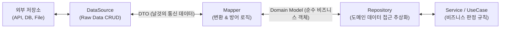

# C# 아키텍처 바이블: 근본 원리부터 클린 아키텍처 & 기술 면접 완벽 대비

> **본 가이드는 C#을 활용한 현대적 애플리케이션 아키텍처의 핵심 원리와 실무 패턴을 단계별로 정리한 복습 및 기술 면접 대비 마크다운 문서입니다.**
> 단순한 문법 습득을 넘어 **"왜 이러한 패턴과 구조가 탄생했는가?"**에 대한 근본적인 철학과 트레이드오프를 체득할 수 있도록 구성되었습니다.
> 자매 가이드: [Java vs C# 객체지향 프로그래밍(OOP) 핵심 원리와 언어 비교 바이블](java_vs_csharp_oop_core_guide.md)

---

## 📑 전체 목차

1. [현대적 C#과 함수형 패러다임 (Functional Programming & LINQ)](#1-현대적-c과-함수형-패러다임-functional-programming--linq)
2. [견고한 예외 처리와 리소스 수명 주기 관리 (Exception & I/O Resource)](#2-견고한-예외-처리와-리소스-수명-주기-관리-exception--io-resource)
3. [데이터 포맷과 네트워크 통신 (Serialization & HTTP)](#3-데이터-포맷과-네트워크-통신-serialization--http)
4. [고성능 비동기 프로그래밍 (Asynchronous Programming)](#4-고성능-비동기-프로그래밍-asynchronous-programming)
5. [데이터 계층 분리와 추상화 (DataSource, DTO, Mapper, Model, Repository)](#5-데이터-계층-분리와-추상화-datasource-dto-mapper-model-repository)
6. [품질 검증과 실패 모델링 (Unit Test & Result Pattern)](#6-품질-검증과-실패-모델링-unit-test--result-pattern)
7. [객체지향 설계 원칙과 클린 아키텍처 (OOP Principles, Design Patterns & Clean Architecture)](#7-객체지향-설계-원칙과-클린-아키텍처-oop-principles-design-patterns--clean-architecture)
8. [부록: C# 아키텍처 핵심 기술 면접 20문 20답 & 종합 치트시트](#8-부록-c-아키텍처-핵심-기술-면접-20문-20답--종합-치트시트)

---

## 1. 현대적 C#과 함수형 패러다임 (Functional Programming & LINQ)

### 1.1 근본 원리: 왜 함수형 패러다임을 도입했는가?

C#은 순수한 객체지향 프로그래밍(OOP) 언어로 출발했으나, 멀티코어 프로세서의 보급과 상태(State) 변이로 인한 동시성 버그를 줄이기 위해 **함수형 프로그래밍(FP)**의 장점을 적극 흡수한 멀티 패러다임 언어로 진화했습니다.

* **1급 객체 (First-Class Citizen)**:
  * 변수에 대입할 수 있는 객체를 1급 객체라 합니다.
  * 대표적인 1급 객체: 기본 값(Value), 인스턴스(Object Reference), **함수(Function)**.
  * 함수가 1급 객체로 취급된다는 것은 함수를 **변수에 저장**, **인자로 전달**, **반환값으로 반환**할 수 있음을 의미합니다.
* **수학적 순수 함수 (Pure Function)**:
  * 동일한 입력(x)에 대해 항상 동일한 출력(f(x) = 2x + 3)을 보장합니다.
  * 외부 상태를 변경하지 않는 **부수 효과(Side Effect)의 제거**가 핵심입니다.
* **메서드 vs 함수**:
  * **메서드(Method)**: 특정 클래스/구조체에 종속되며, 인스턴스의 내부 상태를 조작하기 위한 소속된 서브루틴입니다.
  * **함수(Function)**: 입출력의 매핑 그 자체이며, 소속된 이름보다 전달되는 행위(시그니처)가 핵심입니다.

### 1.2 핵심 문법 및 구현

#### (1) 대리자(Delegate)와 내장 대리자 (`Func`, `Action`, `Predicate`)

C#에서 델리게이트는 **"타입 안전한 함수 포인터(Type-safe Function Pointer)"**입니다.

```csharp
// 1. 커스텀 델리게이트 선언
public delegate int Calculate(int a, int b);

// 2. C# 내장 제네릭 델리게이트 활용 (실무 표준)
// Action: 반환값이 없는(void) 함수
Action<string> printLog = message => Console.WriteLine($"[LOG] {message}");

// Func: 마지막 타입 인자가 반환값인 함수
Func<int, int, int> add = (a, b) => a + b;

// Predicate: 조건을 검사하여 bool을 반환하는 함수 (Func<T, bool>과 호환)
Predicate<int> isEven = x => x % 2 == 0;
```

#### (2) 람다식(Lambda Expression)과 익명 함수

* 별도의 메서드 정의 없이, 실행 위치에서 즉시 인라인으로 생성하는 이름 없는 함수입니다.
* 문법: `(매개변수) => 식 또는 블록`

```csharp
// 식 본문 람다 (Expression Lambda)
Func<int, int> square = x => x * x;

// 문 본문 람다 (Statement Lambda)
Func<int, int, int> safeDiv = (a, b) =>
{
    if (b == 0) throw new DivideByZeroException();
    return a / b;
};
```

#### (3) 고계 함수(Higher-Order Function)와 LINQ

고계 함수란 **다른 함수를 매개변수로 받거나 함수를 반환하는 함수**입니다. C#의 LINQ(Language Integrated Query)는 고계 함수의 정수입니다.

| LINQ 연산자 | 함수형 표준 개념 | 설명 |
|---|---|---|
| `Where` | Filter | 조건을 만족하는 요소만 추출 |
| `Select` | Map / Transform | 요소를 새로운 형태로 투영 및 변환 |
| `Aggregate` | Reduce / Fold | 누적 함수를 적용해 컬렉션을 단일 값으로 축소 |
| `Any` / `All` | Quantifier | 조건을 만족하는 요소의 존재 여부 판단 |
| `ForEach` | Side Effect | 각 요소에 대해 지정된 액션 실행 |
| `ToList` / `ToHashSet` | Materialize | 지연 평가된 시퀀스를 실제 메모리 컬렉션으로 실체화 및 중복 제거 |

```csharp
var numbers = new List<int> { 1, 2, 3, 4, 5, 6 };

// Where & Select를 활용한 선언형 데이터 파이프라인
var evenSquares = numbers
    .Where(n => n % 2 == 0) // 짝수 필터링 (고계 함수: Predicate 전달)
    .Select(n => n * n)     // 제곱 변환 (고계 함수: Transformer 전달)
    .ToList();              // 즉시 평가 (Materialization)

// Aggregate (누적 축소): 합계 계산
int totalSum = numbers.Aggregate(0, (acc, next) => acc + next);
```

#### (4) 실전 연습: 트랜잭션 도메인 쿼리 풀이

슬라이드에 수록된 고전 LINQ 쿼리 종합 예제입니다.

```csharp
public class Trader
{
    public string Name { get; set; }
    public string City { get; set; }
    public Trader(string name, string city) { Name = name; City = city; }
}

public class Transaction
{
    public Trader Trader { get; set; }
    public int Year { get; set; }
    public int Value { get; set; }
    public Transaction(Trader trader, int year, int value)
    {
        Trader = trader; Year = year; Value = value;
    }
}

// 실전 질의 모음
var transactions = new List<Transaction>
{
    new Transaction(new Trader("Brian", "Cambridge"), 2011, 300),
    new Transaction(new Trader("Raoul", "Cambridge"), 2012, 1000),
    new Transaction(new Trader("Raoul", "Cambridge"), 2011, 400),
    new Transaction(new Trader("Mario", "Milan"), 2012, 710),
    new Transaction(new Trader("Mario", "Milan"), 2012, 700),
    new Transaction(new Trader("Alan", "Cambridge"), 2012, 950)
};

// 1. 2011년에 발생한 모든 트랜잭션을 가격 오름차순으로 정렬하여 거래자 이름 추출
var q1 = transactions
    .Where(t => t.Year == 2011)
    .OrderBy(t => t.Value)
    .Select(t => t.Trader.Name);

// 2. 거래자가 근무하는 모든 도시를 중복 없이 나열
var q2 = transactions.Select(t => t.Trader.City).Distinct();

// 3. 케임브리지에서 근무하는 모든 거래자를 찾아 이름순으로 정렬
var q3 = transactions
    .Select(t => t.Trader)
    .Where(trader => trader.City == "Cambridge")
    .DistinctBy(trader => trader.Name)
    .OrderBy(trader => trader.Name);

// 4. 밀라노에 거래자가 있는가?
bool q4 = transactions.Any(t => t.Trader.City == "Milan");

// 5. 전체 트랜잭션 중 최댓값과 최솟값
int maxValue = transactions.Max(t => t.Value);
int minValue = transactions.Min(t => t.Value);
```

---

## 2. 견고한 예외 처리와 리소스 수명 주기 관리 (Exception & I/O Resource)

### 2.1 근본 원리: 예외(Exception)와 에러의 본질

소프트웨어 실행 중 발생할 수 있는 이상 상태를 3가지로 분류하고 그에 맞게 대처해야 합니다.

1. **문법 에러 (Syntax Error)**: 컴파일러가 잡아내는 형식적 코드 오류 $\rightarrow$ 빌드 시점 100% 제거 가능.
2. **런타임 에러 (Runtime Error)**: 실행 중 파일 누락, 네트워크 단절, 메모리 고갈 등 예상치 못한 외부 환경 요인으로 발생 $\rightarrow$ **예외 처리(Exception Handling)**의 대상.
3. **논리 에러 (Logic Error)**: 문법도 맞고 실행도 되지만, 요구사항과 다른 계산 결과를 내는 버그 $\rightarrow$ **단위 테스트(Unit Test)**로 사전 방지.

### 2.2 리소스 관리와 `IDisposable`

운영체제의 파일 핸들, 소켓, DB 커넥션 등은 .NET 가비지 컬렉터(GC)가 제어하지 못하는 **비관리 리소스(Unmanaged Resources)**입니다.

* 리소스를 열었으면(`Open`), 작업 후 반드시 즉시 닫아야(`Close`) 누수(Leak)를 막을 수 있습니다.
* C#은 이를 보장하기 위해 `IDisposable` 인터페이스와 `using` 문을 제공합니다.

```csharp
// C# 8.0 이전: 중첩 try-finally 블록
FileStream fs = null;
try
{
    fs = new FileStream("log.txt", FileMode.Open);
    // 작업 수행
}
finally
{
    if (fs != null) fs.Dispose();
}

// C# 8.0 이상: using 선언 (스코프 종료 시 자동 Dispose 보장)
public void CopyFileSafely(string sourcePath, string destPath)
{
    using var reader = new StreamReader(sourcePath);
    using var writer = new StreamWriter(destPath);
    
    string line;
    while ((line = reader.ReadLine()) != null)
    {
        writer.WriteLine(line);
    }
}
```

### 2.3 실무 원칙: 예외 처리 Anti-Pattern 경계

* **Catch-All 무시(Swallowing) 금지**: `catch (Exception) { /* 빈 블록 */ }`은 디버깅을 불가능하게 만드는 최악의 패턴입니다.
* **흐름 제어용 예외 금지**: `try-catch` 블록 진입과 스택 트레이스 생성은 엄청난 CPU 오버헤드를 유발합니다. 일반적인 비즈니스 분기(예: 입력값 누락, 비밀번호 불일치)에는 예외 대신 **Result 패턴**을 적용해야 합니다.
* **Rethrow 시 스택 보존**: `catch (Exception ex) { throw ex; }`는 원래 스택 트레이스를 날려버립니다. 반드시 `throw;`를 사용해야 합니다.

---

## 3. 데이터 포맷과 네트워크 통신 (Serialization & HTTP)

### 3.1 근본 원리: 데이터 교환 형식의 진화

```
[CSV] (경량, 2차원 표 구조, 중첩/계층 표현 불가능)
   ↓
[XML] (태그 기반 정밀한 스키마, 가독성 높으나 오버헤드와 장황함 극심)
   ↓
[JSON] (Key-Value 기반, 경량, 계층 구조 지원, 전 세계 웹/앱 통신의 사실상 표준)
```

* **직렬화 (Serialization)**: 메모리 상의 C# 객체(인스턴스) $\rightarrow$ 네트워크 전송 및 파일 저장이 가능한 바이트/문자열 스트림.
* **역직렬화 (Deserialization)**: 문자열/바이트 스트림 $\rightarrow$ 타입 안전한 C# 인스턴스로 복원.

### 3.2 HTTP 기초와 RESTful API

* **URI / URL**: 자원의 고유 식별자.
* **HTTP 메서드와 멱등성(Idempotency)**:
  * `GET`: 자원 조회 (안전하며 멱등함, Body 지양).
  * `POST`: 신규 자원 생성 (비멱등, 호출할 때마다 새로운 데이터 생성).
  * `PUT`: 자원 전체 덮어쓰기 (멱등함).
  * `PATCH`: 자원 부분 수정 (상황에 따라 멱등/비멱등).
  * `DELETE`: 자원 삭제 (멱등함).

### 3.3 C# `HttpClient`의 근본적 함정과 해결책

많은 주니어 개발자가 `using (var client = new HttpClient())` 형태로 매 요청마다 인스턴스를 생성하고 폐기합니다.

* **문제 (소켓 고갈, Socket Exhaustion)**: `HttpClient`가 폐기되어도 내부 OS 소켓은 즉시 닫히지 않고 `TIME_WAIT` 상태로 대기합니다. 요청이 몰리면 열 수 있는 소켓 포트가 고갈되어 애플리케이션 전체가 먹통이 됩니다.
* **해결책**:
  * 단일 인스턴스를 `static` 또는 싱글톤으로 재사용.
  * 최신 .NET 권장: `IHttpClientFactory`를 DI로 주입받아 핸들러 수명 주기를 풀링(Pooling) 관리.

```csharp
public class NetworkService
{
    private readonly HttpClient _httpClient;

    // 의존성 주입을 통한 HttpClient 수명 주기 관리
    public NetworkService(HttpClient httpClient)
    {
        _httpClient = httpClient;
    }

    public async Task<string> DownloadJsonAsync(string url)
    {
        using var response = await _httpClient.GetAsync(url);
        response.EnsureSuccessStatusCode(); // 2xx 상태 코드가 아니면 예외 발생
        return await response.Content.ReadAsStringAsync();
    }
}
```

---

## 4. 고성능 비동기 프로그래밍 (Asynchronous Programming)

### 4.1 근본 원리: 동기 vs 비동기, CPU-Bound vs I/O-Bound

```
[ 동기 (Synchronous) ]
스레드: [----작업 A (28초 대기: 파일/네트워크)----] -> [작업 B 실행] (메인 스레드 멈춤/UI 프리징)

[ 비동기 (Asynchronous) ]
스레드: [작업 A 요청] -> [작업 B 즉시 실행 (UI 반응 유지)] -> [A 완료 시 통지 및 후속 처리]
```

* **동기(Sync)**: 앞선 작업이 끝날 때까지 스레드가 블로킹되어 아무 일도 못함 (1차선 도로의 병목).
* **비동기(Async)**: 지연 작업(I/O, 네트워크 대기)을 운영체제 커널 비동기 I/O 완성 포트(IOCP)에 위임하고, 스레드는 즉각 반환되어 다른 작업을 수행.
* **핵심 목표**: **"메인 스레드(UI/요청 처리)를 절대 차단하지 않는다."**

### 4.2 TAP (Task-based Asynchronous Pattern)과 `async` / `await`

* `async` 키워드는 컴파일러에게 해당 메서드가 **상태 머신(State Machine)**으로 분할되어야 함을 알립니다.
* `await`를 만나면:
  1. 현재 작업을 스케줄러에 등록하고 메서드를 즉시 탈출(Yield).
  2. 호출자(UI 스레드 등)는 자유로워져 다른 이벤트 루프를 처리.
  3. 비동기 작업이 완료되면, 나머지 코드가 캡처된 동기화 컨텍스트(SynchronizationContext) 또는 스레드 풀에서 이어서 실행(Resume).

### 4.3 실전 비동기 주의사항 (기술 면접 빈출)

| 구분 | 위험성 및 이유 | 올바른 접근법 |
|---|---|---|
| `async void` 금지 | 예외 발생 시 호출 스택으로 전파되지 않고 프로세스가 강제 크래시됨 | 이벤트 핸들러를 제외하고는 항상 `async Task`를 사용 |
| `.Result` / `.Wait()` 동기 블로킹 금지 | UI 컨텍스트가 대기 중인데 후속 작업이 같은 컨텍스트를 기다려 상호 교착(Deadlock) 발생 | 최상단까지 일관되게 `await`로 전파 (Async all the way) |
| 순수 I/O에 `Task.Run` 남용 금지 | 파일/네트워크 I/O는 스레드가 필요 없는데 불필요한 스레드 풀 스레드를 낭비함 | 순수 비동기 I/O API(`ReadAsync`, `GetAsync`) 직접 활용 |

---

## 5. 데이터 계층 분리와 추상화 (DataSource, DTO, Mapper, Model, Repository)

### 5.1 왜 계층을 분리하는가? (스파게티 코드 탈출)

초기 프로젝트는 UI나 비즈니스 로직 안에서 직접 SQL을 날리거나 JSON을 파싱합니다.

* **유지보수 지옥**: API 스키마 변경 시 화면 코드 수십 군데가 깨짐.
* **테스트 불가능**: 실제 네트워크와 DB가 켜져 있어야만 코드를 검증할 수 있음.
* **책임 혼재**: 한 클래스가 통신, 파싱, 비즈니스 계산, 화면 렌더링을 모두 수행함.

이를 해결하기 위해 **5단계 데이터 아키텍처**를 수립합니다.



### 5.2 각 계층의 정의와 구체적 역할

#### (1) DataSource 계층

* **책임**: 외부 데이터 저장소(Remote API, SQLite, PlayerPrefs, File)와 **직접 통신하는 최하단 계층**.
* **규칙**:
  * 비즈니스 로직을 전혀 알지 못함.
  * 서버에서 내려온 원시 문자열, 바이트, 또는 날것의 **DTO(Data Transfer Object)**를 그대로 반환.
  * `IRemoteDataSource`, `ILocalDataSource`로 인터페이스 분리.

#### (2) DTO (Data Transfer Object)

* **책임**: 네트워크 통신 규격이나 DB 스키마 형태를 1:1로 반영하는 **직렬화/역직렬화 전용 껍데기 객체**.
* **분리 이유**:
  * 서버의 JSON 필드명이 변경되거나 `snake_case`인 경우.
  * 특정 필드가 `null`로 내려오거나 동적 타입(동적 JSON)인 경우.
  * 불필요한 메타데이터 필드가 다수 포함된 경우.
  * **도메인 모델의 순수성을 지키기 위한 방화벽 역할**.

#### (3) Mapper (매퍼)

* **책임**: DTO를 신뢰할 수 있는 Domain Model로 변환하거나, 반대로 Model을 전송용 DTO로 변환.
* **핵심 구현**: C# **확장 메서드(Extension Methods)**를 활용한 가독성 높은 매핑.
* **방어적 변환**: `null` 필드 기본값 치환, 날짜 포맷 파싱 검증, 안전한 형변환 수행.

#### (4) Model (Domain Model)

* **책임**: 우리 애플리케이션의 **핵심 비즈니스 개념을 표현하는 순수한 객체**.
* **특징**:
  * 외부 라이브러리(Json.NET, DB ORM 속성 등)에 의존하지 않음.
  * **불변 객체(Immutable Object)**로 작성하는 것이 이상적 $\rightarrow$ C# `record` 권장.
  * 동등성 비교(`Equals`, `GetHashCode`), `ToString`이 값 기반으로 자동 구현됨.

#### (5) Repository 계층

* **책임**: 비즈니스 계층에게 필요한 **도메인 데이터 접근의 진입점을 제공하고, 데이터 소스를 캡슐화**.
* **특징**:
  * 로컬 캐시(메모리/DB)와 원격 서버(Remote DataSource)를 조율.
  * 화면이나 서비스는 데이터가 서버에서 오는지 로컬 파일에서 오는지 알 필요가 없음.
  * 항상 **인터페이스(`IRepository`)**를 통해 노출하여 단위 테스트 시 손쉬운 Mocking 지원.

### 5.3 완벽한 C# 코드 예제: 포켓몬 데이터 파이프라인

```csharp
// ==========================================
// 1. DTO (서버 JSON 규격 그대로 반영)
// ==========================================
public class PokemonDto
{
    [JsonPropertyName("id")]
    public int Id { get; set; }

    [JsonPropertyName("name")]
    public string? RawName { get; set; }

    [JsonPropertyName("base_experience")]
    public int? BaseExperience { get; set; }
}

// ==========================================
// 2. Domain Model (불변 record)
// ==========================================
public record Pokemon(int Id, string Name, int Exp);

// ==========================================
// 3. Mapper (확장 메서드로 DTO -> Model 변환)
// ==========================================
public static class PokemonMapper
{
    public static Pokemon ToModel(this PokemonDto dto)
    {
        return new Pokemon(
            Id: dto.Id,
            Name: dto.RawName ?? "Unknown Pokemon", // 방어 로직: Null Safe
            Exp: dto.BaseExperience ?? 0
        );
    }
}

// ==========================================
// 4. DataSource Interface & Implementation
// ==========================================
public interface IPokemonDataSource
{
    Task<PokemonDto> FetchPokemonByIdAsync(int id);
}

public class PokemonRemoteDataSource : IPokemonDataSource
{
    private readonly HttpClient _client;
    public PokemonRemoteDataSource(HttpClient client) => _client = client;

    public async Task<PokemonDto> FetchPokemonByIdAsync(int id)
    {
        var response = await _client.GetFromJsonAsync<PokemonDto>($"https://pokeapi.co/api/v2/pokemon/{id}");
        return response ?? throw new InvalidOperationException("응답이 비어있습니다.");
    }
}

// ==========================================
// 5. Repository Interface & Implementation
// ==========================================
public interface IPokemonRepository
{
    Task<Pokemon> GetPokemonAsync(int id);
}

public class PokemonRepositoryImpl : IPokemonRepository
{
    private readonly IPokemonDataSource _remoteDataSource;
    private readonly Dictionary<int, Pokemon> _memoryCache = new();

    public PokemonRepositoryImpl(IPokemonDataSource remoteDataSource)
    {
        _remoteDataSource = remoteDataSource;
    }

    public async Task<Pokemon> GetPokemonAsync(int id)
    {
        // 1. 캐시 확인
        if (_memoryCache.TryGetValue(id, out var cached))
            return cached;

        // 2. DataSource로부터 DTO 수신
        var dto = await _remoteDataSource.FetchPokemonByIdAsync(id);

        // 3. Mapper를 거쳐 도메인 모델로 변환
        var pokemon = dto.ToModel();

        // 4. 캐시 저장 후 도메인 반환
        _memoryCache[id] = pokemon;
        return pokemon;
    }
}
```

---

## 6. 품질 검증과 실패 모델링 (Unit Test & Result Pattern)

### 6.1 단위 테스트 이론과 F.I.R.S.T 원칙

단위 테스트는 애플리케이션의 가장 작은 단위(함수/클래스)가 설계대로 동작하는지 검증하는 안전망입니다.

* **회귀 방지**: 리팩터링 및 신규 기능 추가 시 기존 기능의 파손 여부를 1초 만에 감지.
* **F.I.R.S.T 원칙**:
  * **Fast (빠름)**: 테스트는 수 밀리초 단위로 수천 개가 실행되어야 함.
  * **Independent (독립적)**: 테스트 간 실행 순서나 공유 상태에 의존하지 않아야 함.
  * **Repeatable (반복 가능)**: 개발 환경, CI 서버, 오프라인 등 어떤 환경에서도 동일한 결과.
  * **Self-Validating (자체 검증)**: 결과가 성공/실패(Pass/Fail) bool 형태로 명확해야 함.
  * **Timely (적시성)**: 제품 코드가 배포되기 직전이나 작성 직전에 작성 (TDD 사이클).

### 6.2 AAA (Arrange - Act - Assert) 패턴

모든 단위 테스트는 명확한 3단계로 구조화합니다.

```csharp
[Fact]
public async Task GetPokemon_WhenValidId_ReturnsMappedDomainModel()
{
    // 1. Arrange (준비): 테스트 대역(Mock/Stub) 준비 및 의존성 주입
    var mockDataSource = new Mock<IPokemonDataSource>();
    mockDataSource.Setup(ds => ds.FetchPokemonByIdAsync(25))
                  .ReturnsAsync(new PokemonDto { Id = 25, RawName = "pikachu", BaseExperience = 112 });

    var repository = new PokemonRepositoryImpl(mockDataSource.Object);

    // 2. Act (실행): 테스트 대상 메서드 호출
    var result = await repository.GetPokemonAsync(25);

    // 3. Assert (검증): 결과가 기대치와 일치하는지 단언
    Assert.Equal(25, result.Id);
    Assert.Equal("pikachu", result.Name);
    Assert.Equal(112, result.Exp);
}
```

### 6.3 전통적 `try-catch`의 한계와 Result 패턴

#### 왜 Result 패턴인가?

1. **암묵적 에러 흐름의 위험성**: C#은 Java와 달리 `throws` 절(Checked Exception)이 없습니다. 메서드 시그니처만 보고는 어떤 예외가 터질지 알 수 없어 호출자가 모든 잠재적 예외를 추적하기 어렵습니다.
2. **에러는 예외가 아니다**: "ID에 해당하는 사용자가 없음", "네트워크 불안정으로 타임아웃", "잔액 부족" 등은 시스템의 치명적 결함(Crash)이 아니라 **비즈니스 도메인 상에서 일상적으로 발생하는 예측 가능한 실패**입니다.
3. **타입 기반의 컴파일 타임 검증**: 성공 결과(`T`)와 실패 결과(`E`)를 하나의 유니온 타입으로 반환하여, 호출자가 실패 처리를 누락하지 못하도록 컴파일 단계에서 강제합니다.

#### 현대적 C# Result 패턴 구현 (`sealed class` & `record`)

```csharp
// 도메인 에러 열거형 정의
public enum NetworkError
{
    NotFound,
    Timeout,
    Unknown
}

// 공용 Result 추상 타입
public abstract record Result<T, E>
{
    private Result() { } // 외부 상속 방지

    public sealed record Success(T Data) : Result<T, E>;
    public sealed record Failure(E Error) : Result<T, E>;
}

// Repository 또는 Service에서의 활용
public class SafePokemonRepository
{
    public async Task<Result<Pokemon, NetworkError>> GetPokemonSafelyAsync(int id)
    {
        try
        {
            // 네트워크 조회 시뮬레이션
            if (id <= 0) 
                return new Result<Pokemon, NetworkError>.Failure(NetworkError.NotFound);

            var pokemon = new Pokemon(id, "Pikachu", 100);
            return new Result<Pokemon, NetworkError>.Success(pokemon);
        }
        catch (TimeoutException)
        {
            return new Result<Pokemon, NetworkError>.Failure(NetworkError.Timeout);
        }
        catch (Exception)
        {
            return new Result<Pokemon, NetworkError>.Failure(NetworkError.Unknown);
        }
    }
}

// 클라이언트에서의 패턴 매칭 처리 (우아한 소비)
public void DisplayPokemon(Result<Pokemon, NetworkError> result)
{
    string message = result switch
    {
        Result<Pokemon, NetworkError>.Success s => $"성공: {s.Data.Name} (Exp: {s.Data.Exp})",
        Result<Pokemon, NetworkError>.Failure f => f.Error switch
        {
            NetworkError.NotFound => "해당 포켓몬을 찾을 수 없습니다.",
            NetworkError.Timeout => "서버 응답 시간이 초과되었습니다.",
            NetworkError.Unknown => "알 수 없는 오류가 발생했습니다."
        }
    };

    Console.WriteLine(message);
}
```

---

## 7. 객체지향 설계 원칙과 클린 아키텍처 (OOP Principles, Design Patterns & Clean Architecture)

### 7.1 응집도(Cohesion)와 결합도(Coupling)

소프트웨어 설계의 최고 지향점은 **"높은 응집도(High Cohesion), 낮은 결합도(Low Coupling)"**입니다.

* **응집도 (Cohesion)**: 하나의 모듈(클래스)이 **단 하나의 명확한 목적을 위해 얼마나 집중되어 있는가?**
  * *나쁜 예*: `Util` 클래스에 문자열 파싱, 파일 쓰기, DB 쿼리가 마구 섞여 있음 (낮은 응집도).
  * *좋은 예*: `UserAuthenticator` 클래스는 로그인/로그아웃/토큰 발급에만 전념함 (높은 응집도).
* **결합도 (Coupling)**: 모듈 간의 **의존성 척도**. 하나의 클래스가 수정될 때 다른 클래스가 얼마나 전파 영향을 받는가?
  * *나쁜 예*: A 클래스가 B 클래스의 구체적인 내부 필드와 메서드 구현을 직접 `new`해서 참조함 (높은 결합도).
  * *좋은 예*: 인터페이스(`IBService`)를 통해 소통하여 구체 구현체가 바뀌어도 A 클래스는 영향 없음 (낮은 결합도).

### 7.2 SOLID 5대 설계 원칙

| 원칙 | 명칭 | 핵심 의미 | C# 아키텍처 적용 예시 |
|---|---|---|---|
| **SRP** | 단일 책임 원칙 (Single Responsibility) | 클래스는 단 하나의 변경 이유만 가져야 한다. | `Repository`는 데이터 조회에만 집중하고, 비즈니스 규칙 판정은 `Service`로 분리 |
| **OCP** | 개방-폐쇄 원칙 (Open-Closed) | 확장에 열려 있고 변경에는 닫혀 있어야 한다. | 새로운 DataSource(예: SQLite $\rightarrow$ Firebase) 추가 시 기존 코드 수정 없이 새 인터페이스 구현체만 추가 |
| **LSP** | 리스코프 치환 원칙 (Liskov Substitution) | 자식 클래스는 부모 클래스의 행동 규약을 깨뜨리지 않고 대체 가능해야 한다. | `MockDataSource`는 실제 `RemoteDataSource`와 동일한 계약 규약을 준수 |
| **ISP** | 인터페이스 분리 원칙 (Interface Segregation) | 클라이언트는 자신이 사용하지 않는 메서드에 의존하지 않아야 한다. | 거대한 `IDataEngine` 대신 `IReadable`, `IWritable` 등 특화된 인터페이스로 쪼갬 |
| **DIP** | 의존성 역전 원칙 (Dependency Inversion) | 상위 모듈은 하위 모듈의 구체 구현이 아닌 추상화(인터페이스)에 의존해야 한다. | `PokemonService`가 구체 클래스가 아닌 `IPokemonRepository`를 주입받음 |

### 7.3 핵심 GoF 디자인 패턴

* **전략 패턴 (Strategy)**: 실행 중에 알고리즘(공격 방식, 결제 수단, 정렬 알고리즘)을 인터페이스로 추상화하여 동적으로 갈아끼울 수 있게 함.
* **옵저버 패턴 (Observer)**: Subject의 상태 변화를 다수의 Observer에게 브로드캐스트 (C#에서는 `event`, `Action`, `IObservable`로 구현).
* **퍼사드 패턴 (Facade)**: 복잡한 하위 서브시스템들(인증, 캐시, 네트워크, 압축)을 배후에 두고, 사용자가 쓰기 편한 단순한 통합 창구를 제공 (이사할 때 주민센터, 카드사, 은행에 일일이 연락하는 대신 일괄 주소이전 서비스 이용).
* **팩토리 메서드 (Factory Method)**: 객체 생성 책임을 서브클래스나 별도 메서드로 위임하여 결합도 완화.

### 7.4 클린 아키텍처와 Service 계층: "미네랄 50개의 진실"

#### Main과 Repository가 비대해지는 문제

초보 개발자는 Main이나 UI(Unity MonoBehaviour, WPF/MAUI Page)에서 Repository 데이터를 직접 받아 온갖 `if-else` 검사를 수행합니다.
화면 코드가 수천 줄의 스파게티 코드가 되고, 동일한 규칙이 다른 화면에 중복 작성됩니다.

#### 스타크래프트 비유: 판단의 주체는 누구인가?

스타크래프트에서 플레이어가 **"마린 생산"** 버튼을 눌렀습니다.

* **SCV**: 미네랄을 캐서 창고에 넣고 빼는 일꾼 $\rightarrow$ **`MineralRepository`** (데이터 접근 계층).
* **마린 버튼**: 화면에 표시되는 UI 버튼 $\rightarrow$ **`View / Presentation`**.
* **"미네랄 50개가 있는가?", "인구수가 남아 있는가?", "배럭이 완공되었는가?"를 판단하는 두뇌**: $\rightarrow$ **`Service` (도메인 비즈니스 규칙 계층)**.

> **"자원이 맵에 없다(Not Found/NetworkError)"**는 **Repository**가 뱉어내는 데이터 실패이고,  
> **"내가 캔 자원이 부족해서 마린을 못 뽑는다(NotEnoughMinerals)"**는 **Service**가 뱉어내는 비즈니스 규칙 실패입니다.  
> 둘은 완전히 다른 종류의 에러입니다!

```csharp
// 비즈니스 규칙 실패 정의
public enum ProductionError
{
    NotEnoughMinerals,
    SupplyDepotExceeded,
    BarracksBusy
}

// 도메인 규칙을 수호하는 Service 계층
public class BarracksService
{
    private readonly IMineralRepository _mineralRepo;
    private readonly ISupplyRepository _supplyRepo;

    public BarracksService(IMineralRepository mineralRepo, ISupplyRepository supplyRepo)
    {
        _mineralRepo = mineralRepo;
        _supplyRepo = supplyRepo;
    }

    public async Task<Result<Unit, ProductionError>> ProduceMarineAsync()
    {
        // 1. 규칙 검증: 미네랄 50원 확인
        int currentMinerals = await _mineralRepo.GetAvailableMineralsAsync();
        if (currentMinerals < 50)
            return new Result<Unit, ProductionError>.Failure(ProductionError.NotEnoughMinerals);

        // 2. 규칙 검증: 인구수 여유 확인
        int maxSupply = await _supplyRepo.GetMaxSupplyAsync();
        int usedSupply = await _supplyRepo.GetCurrentUsedSupplyAsync();
        if (usedSupply + 1 > maxSupply)
            return new Result<Unit, ProductionError>.Failure(ProductionError.SupplyDepotExceeded);

        // 3. 자원 소비 및 유닛 생성
        await _mineralRepo.SpendMineralsAsync(50);
        await _supplyRepo.IncreaseSupplyAsync(1);

        return new Result<Unit, ProductionError>.Success(new Unit("Marine"));
    }
}
```

#### Service 분리 기준: "화면"이 아니라 "도메인"

* ❌ **나쁜 분리 (화면 기준)**: `HomeService`, `SettingsPopupService`, `LevelSelectService`
  * 화면 UI 구조가 바뀔 때마다 백엔드 서비스까지 요동침.
* ⭕ **좋은 분리 (도메인 기준)**: `ProfileService`, `ProgressService`, `WalletService`, `BattleService`
  * 어떤 화면(팝업이든, 전체 화면이든, 콘솔 CLI든)에서도 동일한 도메인 서비스 재사용 가능.

---

## 8. 부록: C# 아키텍처 핵심 기술 면접 20문 20답 & 종합 치트시트

### 8.1 아키텍처 핵심 인터뷰 20선

#### Q1. 델리게이트(Delegate)와 C# 이벤트(Event)의 차이는 무엇인가요?

* **답변**: 델리게이트는 특정 시그니처를 가진 메서드를 참조하는 타입 안전한 함수 포인터 객체입니다. 반면 이벤트는 델리게이트를 기반으로 캡슐화한 언어적 장치입니다. 클래스 외부에서는 오직 구독(`+=`)과 해지(`-=`)만 가능하며, 외부에서 임의로 이벤트를 초기화(`= null`)하거나 직접 호출(Invoke)할 수 없어 객체의 자율성과 캡슐화를 철저히 보호합니다.

#### Q2. 람다식에서 클로저(Closure)가 발생할 때 내부적으로 메모리에서 어떤 일이 일어나는가요?

* **답변**: 람다가 외부 메서드의 지역 변수를 참조(Capture)하면, C# 컴파일러는 보이지 않는 숨겨진 클래스(DisplayClass)를 힙에 생성하고 해당 지역 변수를 그 클래스의 필드로 승격시킵니다. 따라서 스택 프레임이 종료되어도 변수가 힙에 남아 생명주기가 연장되며, 불필요한 캡처가 누적되면 가비지 컬렉터(GC) 압박이 증가하므로 고성능 루프 내에서는 정적 람다(`static () => {}`)를 통해 캡처를 방지하는 것이 좋습니다.

#### Q3. LINQ 연산에서 즉시 평가(Immediate Execution)와 지연 평가(Deferred Execution)의 차이는?

* **답변**: `Where`, `Select` 같은 대부분의 LINQ 쿼리는 선언 시점에 실행되지 않고 열거자(`GetEnumerator()`)가 순회될 때 비로소 하나씩 계산되는 지연 평가를 따릅니다. 반면 `ToList()`, `Count()`, `Aggregate()` 등 시퀀스 전체를 집계하거나 실체화하는 메서드는 호출 즉시 쿼리를 평가하여 메모리에 적재합니다.

#### Q4. `using` 문과 `IDisposable` 인터페이스의 관계, 그리고 가비지 컬렉터(GC)와의 차이점은?

* **답변**: GC는 오직 관리 힙(Managed Heap)의 메모리만 수거하며, OS 파일 핸들이나 DB 연결 같은 비관리 리소스(Unmanaged Resources)의 해제 시점은 알지 못합니다. `IDisposable`을 구현한 객체를 `using` 블록으로 감싸면, 정상 종료든 예외 발생이든 상관없이 `finally` 블록에서 `Dispose()`가 호출되어 비관리 리소스를 결정론적(Deterministic)으로 즉시 해제합니다.

#### Q5. `try-catch`를 비즈니스 분기용 제어 흐름으로 사용하면 안 되는 이유는?

* **답변**: 예외가 던져지면 런타임은 콜 스택 전체를 역추적(Stack Unwinding)하며 예외 객체와 스택 트레이스를 생성합니다. 이는 일반적인 조건문 분기보다 수백~수천 배의 CPU 사이클을 낭비하므로, 정상 흐름에서 빈번히 일어날 수 있는 분기는 반환값(Result 패턴)으로 처리해야 합니다.

#### Q6. `HttpClient`를 매번 `new`로 인스턴스화하고 `Dispose`할 때 발생하는 문제는?

* **답변**: `HttpClient`를 폐기해도 내부 TCP 소켓은 즉시 닫히지 않고 OS 레벨에서 `TIME_WAIT` 상태로 유지됩니다. 고빈도 트래픽 상황에서 소켓이 재사용되지 못해 가용 포트가 고갈되는 소켓 고갈(Socket Exhaustion) 현상이 발생합니다. `IHttpClientFactory`를 사용하여 풀링된 핸들러를 재사용해야 합니다.

#### Q7. 동기 블로킹(`.Result`, `.Wait()`) 호출 시 왜 교착 상태(Deadlock)가 발생할 수 있나요?

* **답변**: UI 프레임워크나 ASP.NET(레거시)은 단일 스레드 기반 동기화 컨텍스트(SynchronizationContext)를 가집니다. 메인 스레드가 `.Result`로 태스크 완료를 동기 대기하는 동안, 비동기 작업이 끝나고 후속 코드를 실행하기 위해 메인 스레드의 컨텍스트 진입을 대기하면서 두 작업이 서로를 영원히 기다리는 교착 상태에 빠집니다.

#### Q8. `async void`의 사용을 원칙적으로 금지하는 이유는?

* **답변**: `async Task`는 발생한 예외를 Task 객체 내부에 담아 호출자에게 전파하지만, `async void`는 반환할 Task가 없어 내부에서 발생한 예외가 동기화 컨텍스트로 바로 던져져 전역 미처리 예외(Uncaught Exception)가 되고 프로세스가 비정상 종료됩니다. UI 이벤트 핸들러 규격을 제외하고는 절대 사용해서는 안 됩니다.

#### Q9. DataSource 계층과 Repository 계층의 책임 경계는 무엇인가요?

* **답변**: DataSource는 외부 데이터 저장소(API 엔드포인트, SQLite 테이블 등)와 직접 닿아 있는 로우 레벨 계층으로 원시 DTO나 JSON을 가져오는 단순 CRUD에 집중합니다. 반면 Repository는 여러 데이터 소스(로컬 DB + 원격 서버)를 통합/조율하고 캐싱 정책을 수행하며, DTO를 도메인 모델로 변환하여 비즈니스 레이어에 순수한 도메인 객체만 노출하는 추상화 계층입니다.

#### Q10. DTO와 도메인 모델을 반드시 분리해야 하는 근본적인 이유는?

* **답변**: 외부 시스템의 데이터 구조는 서버의 스키마 변경, 레거시 필드명, 직렬화 편의성 등으로 인해 수시로 변경될 수 있습니다. DTO를 도메인 모델과 동일시하면 외부 변경 사항이 앱 전역(UI, 비즈니스 로직)으로 전파됩니다. DTO와 Mapper라는 방화벽을 두면 서버 API가 바뀌어도 도메인 로직은 완전히 격리되어 안전합니다.

#### Q11. C#에서 도메인 모델을 클래스 대신 `record`로 선언할 때의 장점은?

* **답변**: `record`는 기본적으로 불변성(Immutability)을 지향하며, 컴파일러가 값 기반 동등성 비교(`Equals`, `GetHashCode`, `==`), 불변 복제(`with` 식), 가독성 높은 `ToString()`을 자동으로 생성해 주므로 상태 변이 버그가 없는 순수한 Value Object를 작성하기에 최적입니다.

#### Q12. Result 패턴이 가져다주는 가장 큰 설계적 이점은?

* **답변**: C#에는 Checked Exception이 없기 때문에 메서드 시그니처만으로 실패 가능성을 인지할 수 없습니다. Result 패턴은 성공 값(`T`)과 실패 사유(`E`)를 타입 시스템에 명시하여, 호출자가 실패 케이스 처리를 누락하는 것을 컴파일 타임에 원천 차단하고 코드가 스스로 문서화되는 효과를 줍니다.

#### Q13. 단위 테스트에서 F.I.R.S.T 원칙 중 'Independent'가 깨지면 어떤 문제가 생기는가요?

* **답변**: 테스트가 공유 상태(전역 변수, 정적 싱글톤, 실제 DB 레코드)를 수정하여 실행 순서에 따라 통과 여부가 달라지면, 특정 테스트가 실패했을 때 코드의 버그 때문인지 이전 테스트의 잔재 때문인지 파악할 수 없어 테스트의 신뢰성이 완전히 붕괴됩니다.

#### Q14. Mock, Stub, Fake의 차이는 무엇인가요?

* **답변**:
  * **Stub**: 테스트 진행을 위해 미리 준비된 고정된 값을 단순히 반환하는 객체.
  * **Mock**: 특정 메서드가 몇 번 호출되었는지, 어떤 인자가 전달되었는지 행위(Behavior)를 검증하기 위한 객체.
  * **Fake**: 실제 객체처럼 동작하지만 운영에는 부적합한 단순화된 구현체 (예: In-Memory Fake Database).

#### Q15. 단일 책임 원칙(SRP)에서 '책임'을 정의하는 올바른 기준은?

* **답변**: 마틴 파울러와 로버트 C. 마틴에 따르면, 책임이란 "해당 클래스를 변경해야 하는 이유"입니다. 즉, "하나의 클래스는 오직 한 명의 액터(Actor, 이해관계자)에 대해서만 책임을 져야 한다"는 뜻입니다. UI 디자이너의 요구와 DB 관리자의 요구를 동시에 받는 클래스는 SRP를 위반한 것입니다.

#### Q16. 의존성 역전 원칙(DIP)을 적용하면 테스트 용이성이 어떻게 개선되는가요?

* **답변**: 상위 모듈이 하위 모듈의 구체 클래스를 직접 생성(`new`)하지 않고 인터페이스를 주입받도록 역전시키면, 단위 테스트 환경에서 무거운 실제 모듈(실제 결제 PG사 통신, 실제 디스크 파일) 대신 메모리 기반의 Mock 객체를 자유자재로 주입할 수 있어 격리된 환경에서 초고속 테스트가 가능해집니다.

#### Q17. Repository와 Service 계층을 분리하는 기준은 무엇인가요?

* **답변**: Repository는 "데이터가 어디에 저장되어 있고 어떻게 읽고 쓰는가(Where & How to store)"를 다루며, Service는 "그 데이터를 바탕으로 어떤 비즈니스 규칙과 제약을 검증하고 조합할 것인가(What business rules to enforce)"를 담당합니다.

#### Q18. Service를 분리할 때 화면 단위(예: `HomeService`)로 쪼개면 안 되는 이유는?

* **답변**: 화면 단위로 서비스를 만들면 UI 기획 변경에 따라 서비스가 함께 흔들리며, 여러 화면에서 동일한 도메인 로직(예: 잔액 차감)을 중복 구현하게 됩니다. 서비스는 화면이 아닌 `WalletService`, `BattleService`처럼 도메인 단위로 쪼개야 여러 뷰에서 재사용할 수 있습니다.

#### Q19. 전략 패턴(Strategy Pattern)과 상태 패턴(State Pattern)의 차이는?

* **답변**: 두 패턴 모두 인터페이스 기반 다형성을 이용하지만 의도가 다릅니다. 전략 패턴은 클라이언트가 필요에 따라 알고리즘(예: 할인 정책, 경로 탐색)을 직접 교체하여 주입하는 반면, 상태 패턴은 객체 내부의 상태 전이(State Transition)에 따라 스스로 행동 객체를 전환합니다.

#### Q20. 클린 아키텍처에서 '의존성 규칙(Dependency Rule)'이란 무엇인가요?

* **답변**: "모든 소스 코드의 의존성은 반드시 바깥쪽 원(세부사항: UI, DB, 웹 프레임워크)에서 안쪽 원(고수준 정책: UseCase, Domain Entity)을 향해야 한다"는 원칙입니다. 즉, 핵심 도메인 모델과 비즈니스 로직은 프레임워크나 DB 기술의 존재를 전혀 몰라야 하며, 외부 기술이 교체되어도 도메인은 절대 수정되지 않아야 합니다.

---

### 8.2 한 장으로 끝내는 계층별 역할 치트시트

```
┌────────────────────────────────────────────────────────────────────────┐
│                        Presentation Layer                              │
│   - UI View, Controller, MonoBehaviour, WPF/MAUI ViewModel             │
│   - 화면 렌더링, 사용자 입력 수신, 사용자 인터랙션 처리               │
└───────────────────────────────────┬────────────────────────────────────┘
                                    │ (호출)
                                    ▼
┌────────────────────────────────────────────────────────────────────────┐
│                        Domain / Service Layer                          │
│   - UseCase, Service (도메인 단위: WalletService, BattleService)       │
│   - 비즈니스 판정 규칙 ("자원이 충분한가?", "자격 조건 검증")          │
│   - 여러 Repository 조합 및 Result<T, Error> 반환                      │
└───────────────────────────────────┬────────────────────────────────────┘
                                    │ (호출: IRepository 인터페이스 경유)
                                    ▼
┌────────────────────────────────────────────────────────────────────────┐
│                          Data / Repository Layer                       │
│   - Repository (Domain Data Access 추상화 및 은닉)                     │
│   - 캐시 조율 (Memory Cache + Remote 통신 결합)                        │
│   - Mapper를 통해 DTO <-> Domain Model 변환                            │
└───────────────────────────────────┬────────────────────────────────────┘
                                    │ (호출: IDataSource 인터페이스 경유)
                                    ▼
┌────────────────────────────────────────────────────────────────────────┐
│                          DataSource Layer                              │
│   - RemoteDataSource (HTTP/REST), LocalDataSource (SQLite/File)        │
│   - 외부 I/O 직접 통신, Raw Data CRUD, DTO 직렬화/역직렬화             │
└────────────────────────────────────────────────────────────────────────┘
```
